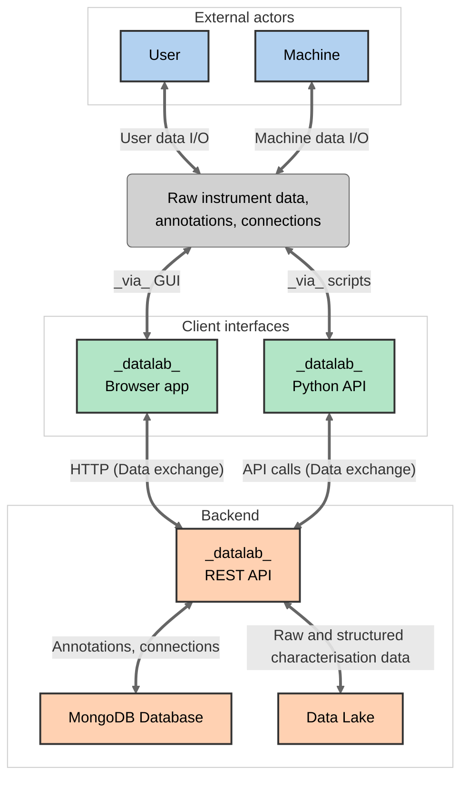

# About *datalab*

--8<-- "README.md:intro"

The main aim of *datalab* is to capture the significant amounts of long-tail experimental
data and metadata produced in a typical lab, and to enable storage, filtering and future
data re-use by both humans and machines.

## Features

--8<-- "README.md:features"

## Design philosophy and architecture

The _datalab_ architecture is shown below:

The main aim of *datalab* is to provide a platform for capturing the significant amounts of long-tail experimental data and metadata produced in a typical lab, and enable storage, filtering and future data re-use by humans and machines. *datalab* is targeted (broadly) at materials chemistry labs but with customisability and extensability in mind.

The platform provides researchers with a way to record sample- and cell-specific metadata, attach and sync raw data from instruments, and perform analysis and visualisation of many characterisation techniques in the browser (XRD, NMR, electrochemical cycling, TEM, TGA, Mass Spec, Raman).

Importantly, *datalab* stores a network of interconnected research objects in the lab, such that individual pieces of data are stored with the context needed to make them scientifically useful.

## Citation

Should you use *datalab* in your research, please consider citing the following paper:

--8<-- "README.md:citation"

## Contributions

--8<-- "README.md:credits"

## License

*datalab* is released under the terms of the MIT license; see [LICENSE](LICENSE) for the
full text.
