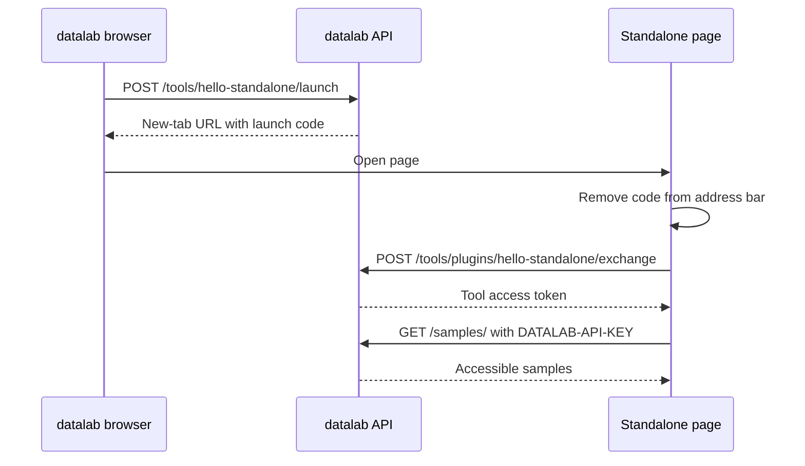

# Developing a standalone tool plugin

This tutorial follows the
[standalone example plugin](https://github.com/Matgenix/datalab-standalone-tool-plugin-example),
a minimal tool that opens in a new tab and prints one message using datalab
data.

Read the shared [tool plugin development guide](tool-plugin.md) first for the
project workflow, provider contract, testing, and release checklist. This page
focuses on the standalone launch and credential flow.

## How it works

The *standalone tool* is like giving a visitor a short-lived badge at reception.
datalab checks that the user is signed in, creates a *launch code*, and
opens the tool page with that code. The tool immediately trades the code for a
*tool access token* and uses that token to ask datalab for data.
The framework automatically protects the page and exchange routes with the
active browser-session policy.
The example uses plain HTML so the access flow is visible. A real standalone
tool can replace `index.html` with any reviewed web app or remote service.



The example displays one sentence: `Hello <user>. You can access <N> sample(s).`

## Walk through the example

The example is equivalent to generating a standalone package from the *Copier*
template:

```shell
uvx copier copy --trust https://github.com/Matgenix/datalab-tool-plugin-template \
  datalab-standalone-tool-plugin-example
```

Use these answers:

```text
tool_name = Hello standalone
tool_id = hello-standalone
distribution_name = datalab-hello-standalone-tool
tool_ui_kind = standalone
tool_open_mode = new_tab
add_item_table_action = true
item_table_action_id = open-selected
item_table_action_label = Open selected
item_table_action_tables = samples, inventory, collection-items
item_table_action_min_items = 1
item_table_action_max_items = 20
```

The important files are:

| File | Purpose |
|---|---|
| `pyproject.toml` | Declares the package and `pydatalab.tools` entry point |
| `src/datalab_hello_standalone_tool/provider.py` | Registers metadata, serves the page, launches the tool, and exchanges codes |
| `src/datalab_hello_standalone_tool/static/index.html` | Exchanges the code, calls `/samples/`, and writes one sentence |

The provider advertises a standalone UI:

```python
metadata = ToolMetadata(
    name="Hello standalone",
    ui=StandaloneToolUI(),
)
```

Its `launch()` method issues a *tool launch grant*:

```python
code = grants.issue(TOOL_ID)
return f"{base_url}index.html#datalab_launch_code={code}"
```

The provider chooses how the resulting delegated session is stored when it
issues the grant. The default is `ToolSessionPolicy.REPLACE`, which replaces
the user's other sessions for the same provider. The selected policy is bound
to the launch grant; an exchange client cannot choose or upgrade it.

Production standalone tools must return an HTTPS launch URL. HTTP is reserved
for local development on explicit loopback hosts (`localhost`,
`*.localhost`, `127.0.0.0/8`, or `::1`); private-LAN HTTP URLs are rejected.
The URL must not contain embedded username or password credentials.

The example also advertises **Open selected** for Samples, Inventory, and
items within a collection. datalab validates the selection and binds it to the
same single-use launch grant. After the exchange, the provider returns it to
the page alongside the tool access token:

```python
if result.selection is not None:
    response_data["selection"] = {
        "action": result.selection.action_id,
        "items": list(result.selection.item_refcodes),
    }
```

A launch from the Tools menu has no selection.

The exchange route consumes the code for the same browser user:

```python
result = exchange_launch_code(
    code,
    TOOL_ID,
    TOOL_ID,
    expected_user_id=str(current_user.person.immutable_id),
)
```

There is no login helper or decorator in this provider. Because its blueprint
uses the default `ToolRouteAuth.BROWSER` policy, datalab authenticates every
route before calling it and rejects *tool access token* issuance requests from untrusted
origins. `expected_user_id` separately ensures that the *tool launch grant* belongs to
that authenticated browser user. This required, keyword-only argument must be a
non-empty immutable user ID; omitting it is an error rather than an unbound
exchange.

Confidential services use a separate API. After datalab has authenticated the
client through a `ToolRouteAuth.SERVICE` provider route, the handler can call
`exchange_service_launch_code(code, TOOL_ID, CLIENT_ID)`. That helper performs
no browser-user binding and does not authenticate the caller, so it must never
be used by this browser-authenticated pattern.

## Access and credential details

The *launch code* and *tool access token* are different objects:

| Value | Lifetime | Who sees it | What it can do |
|---|---|---|---|
| *Launch code* | About 60 seconds, single use | The launched tool page | Can be exchanged once |
| *Tool access token* | About 24 hours by default | The trusted tool page or backend | Authenticates API calls as the *current user* |

The page removes the *launch code* from the URL before doing anything else:

```javascript
launchUrl.hash = "";
window.history.replaceState({}, "", launchUrl);
```

That prevents the *launch code* from being copied, bookmarked, leaked through
screenshots, or left in browser history. The *tool access token* is kept in memory and
sent only in API request headers:

```javascript
fetch(`${apiPrefix}/samples/`, {
  credentials: "omit",
  headers: { "DATALAB-API-KEY": exchange.tool_access_token },
});
```

A provider that needs another lifecycle can opt in explicitly:

```python
from pydatalab.tools import ToolSessionPolicy

code = grants.issue(TOOL_ID, session_policy=ToolSessionPolicy.INDEPENDENT)
```

The three policies are:

| Policy | Sequential behavior |
|---|---|
| `REPLACE` | Issue a new canonical token and revoke other sessions for this user and provider. This is the default. |
| `REUSE_OR_REPLACE` | Reuse the exact eligible canonical candidate supplied by the trusted application, or perform `REPLACE` on any miss. |
| `INDEPENDENT` | Issue another token without revoking existing sessions. |

The **canonical session** is the single deterministic session record maintained
for one user and provider by `REPLACE`. Only its token can be reused by
`REUSE_OR_REPLACE`; independently issued sessions use separate records and are
not reuse candidates.

For `REUSE_OR_REPLACE`, pass the token already held by the trusted application
as `candidate_tool_access_token` and, if needed, require a minimum remaining
lifetime:

```python
code = grants.issue(
    CLIENT_ID,
    session_policy=ToolSessionPolicy.REUSE_OR_REPLACE,
)

# Later, in the authenticated service exchange route:
result = exchange_service_launch_code(
    code,
    TOOL_ID,
    CLIENT_ID,
    candidate_tool_access_token=existing_token,
    minimum_reuse_lifetime_seconds=10 * 60,
)
```

`result.session_reused` is true only when the returned raw token is exactly the
candidate. Reuse preserves its existing expiry; it does not extend the session.
A missing, expired, near-expiry, or wrongly bound candidate safely falls back
to replacement. The exchange rejects a non-string or excessively long
candidate before consuming the grant. Reuse also falls back when the candidate
would live longer than the lifetime requested by the provider or when another
active independent session exists.

Independent tokens have the same provider-level authority for the user. They
do not create isolated processes, filesystems, item scopes, or permissions.
Use them only when the provider is prepared to manage concurrent credentials.
A later `REPLACE` or unsuccessful `REUSE_OR_REPLACE` collapses those sessions
back to one canonical token.

These guarantees are sequential. Concurrent replacements remain
last-writer-wins, and a token returned by reuse can be revoked immediately by a
later exchange. datalab stores only token hashes in the existing
`tool_sessions` collection; enabling these policies requires neither raw-token
storage nor a database migration or new index.

With the default policy, a successful relaunch replaces the user's previous
tool access token for that provider, even if the new launch uses a different
`client_id`. A tool must handle HTTP 401 by asking the user to relaunch.

Do not store *tool access tokens* in local storage, session storage, notebooks,
persistent files, URLs, analytics, or logs. The token is short-lived, but while
it is valid it carries the user's identity, ownership, and group-based access.
Its effective role is always `user`, so an administrator's delegated token
cannot activate `?sudo=1`, modify other users' objects based on the account's
administrator role, or pass direct administrator-role checks. The role returned
by the launch exchange is this effective delegated role.

### Temporary access restrictions

Access given to a standalone tool is temporary. A tool cannot turn this into
long-lived access by creating API keys or item access tokens. It also cannot
change the user's profile or sign-in methods. If an item access token is
needed, e.g. for a QR code on a physical sample, the user must create it
from datalab in their browser.

## Install and run

Add the plugin to the datalab checkout's root `plugins.toml`:

```toml
dependencies = ["datalab-hello-standalone-tool"]

[tool.uv.sources]
datalab-hello-standalone-tool = { path = "../datalab-standalone-tool-plugin-example", editable = true }
```

Install the plugin into the datalab environment:

```shell
cd pydatalab
uv run invoke dev.install
```

For Docker Compose development, rebuild the API image after adding the plugin:

```shell
docker compose --profile dev up --build
```

Open datalab, click **Tools**, and choose **Hello standalone**.
The example repository's [installation guide](https://github.com/Matgenix/datalab-standalone-tool-plugin-example/blob/main/INSTALL.md)
is the source for its exact setup commands. If a real tool launches a separate
service, document and deploy it according to the
[standalone-service boundary](../deployment.md#plugin-provided-standalone-services).

## Common errors

| Symptom | Likely cause |
|---|---|
| Tool does not appear | The package is not installed, the entry point did not load, or the API server was not restarted |
| `Invalid or expired launch code` | The page was refreshed after the code was consumed, or launch took longer than the *tool launch grant lifetime* |
| `Authentication required` | The route was called without a datalab *browser session* |
| `A browser session is required` | The caller used an inactive account, permanent key, or *tool access token* instead of the *browser session* |
| `Untrusted request origin` | The exchange request did not come from the configured datalab frontend/API origin |
