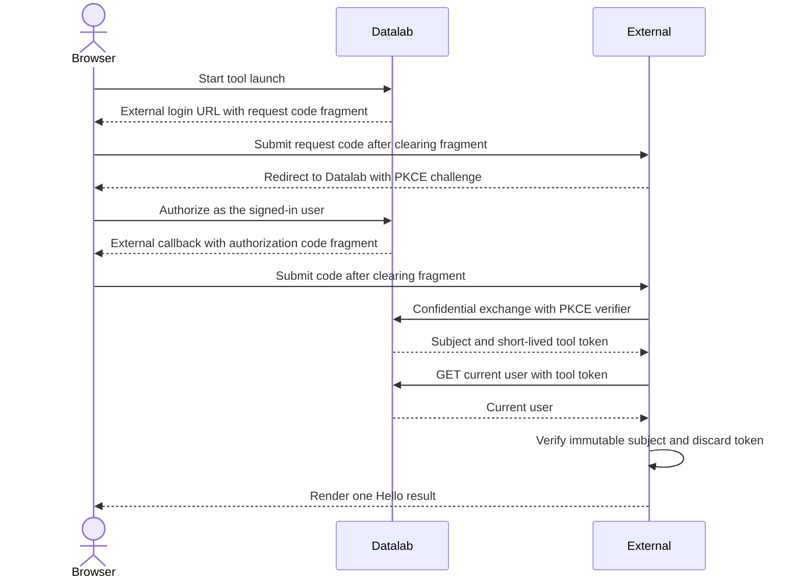

# Developing a standalone tool plugin

The generated standalone project is a real external application with two
separately started runtimes:

1. a small provider adapter installed in the Datalab API; and
2. an external web process on its own origin.

The [standalone Hello example](https://github.com/Matgenix/datalab-standalone-tool-plugin-example)
uses Flask and Gunicorn only as a replaceable reference. It keeps no persistent
external-app login, session, token, database, or result. After the handoff it
makes one subject-checked Datalab request, renders one message, and discards the
token.

Read the shared [tool plugin guide](tool-plugin.md) first. This page explains
the external boundary that must remain when the reference stack is replaced.

## The minimal flow



The browser never receives the tool token. The first code is bound to the
signed-in Datalab user, and the second code can be completed only by the
external browser context holding the short-lived PKCE cookie.

This is an OAuth-like authorization-code handoff using the RFC 7636 proof
construction. Datalab is not presented as a standards-compliant OAuth
authorization server.

## Generated files

| File | Purpose |
|---|---|
| `provider.py` | Datalab-side metadata, service launch, confidential authentication, and exchange |
| `config.py` | Framework-light URL and secret validation shared by both runtimes |
| `service.py` | Replaceable one-shot external Flask implementation |
| `templates/page.html` | One small landing, fragment bridge, result, and error template |
| `.env.example` | Variable names and deliberately unusable placeholders |
| `Dockerfile` | Optional independent external-service image |

The package initializer exports only its version. Therefore the external
service can import `config.py` and `service.py` without installing or importing
`datalab-server`; only the host loads `provider.py` through the
`pydatalab.tools` entry point.

## Provider adapter

The provider uses service authentication, not a Datalab browser session, for
its one route:

```python
class HelloStandaloneToolProvider(ToolProvider):
    route_auth = ToolRouteAuth.SERVICE

    def authenticate_service_request(self) -> bool:
        # Compare the fixed client ID and configured secret in constant time.
        ...
```

`launch()` creates a pending browser-authorized service launch with a fixed
callback and a five-minute lifetime:

```python
code = grants.issue_service_launch(
    TOOL_ID,
    settings.callback_url,
    lifetime_seconds=5 * 60,
)
return f"{settings.login_url}#datalab_launch_code={code}"
```

The confidential `/exchange` route accepts only an authorization code and PKCE
verifier, then calls only the browser-bound helper:

```python
result = exchange_authorized_service_launch_code(
    authorization_code,
    code_verifier,
    TOOL_ID,
    TOOL_ID,
    tool_session_lifetime_seconds=5 * 60,
)
```

The exchange route calls only the browser-authorized service helper. Client
credentials authenticate the external process; they do not identify the
browser user.

## External reference process

The reference app has only `/`, `/healthz`, `/datalab-login`, and
`/datalab-callback`. The two handoff GETs use the same tiny page template. Its
nonce-authorized script reads the fragment, clears the address bar before
validation, and submits the expected field to the same origin.

The login POST checks its Origin and CSRF cookie, creates an RFC 7636 `S256`
verifier/challenge pair, stores only the verifier in a five-minute HttpOnly
cookie, and redirects to Datalab. The callback POST checks a separate CSRF
cookie and the verifier, performs the confidential exchange, and sends the
returned token in one backend `DATALAB-API-KEY` request to
`/v0.1/get-current-user/`. It renders the result only after that response's
`immutable_id` matches the exchange subject.

The token never enters HTML, JavaScript, browser cookies or storage, URLs,
logs, or committed configuration. Refreshing the callback result cannot repeat
the exchange; the user must launch again. A second launch replaces the single
PKCE cookie, so latest launch wins.

## Configuration and running both runtimes

For `hello-standalone`, configure:

| Variable | Used by |
|---|---|
| `DATALAB_HELLO_STANDALONE_PUBLIC_URL` | provider and service |
| `DATALAB_HELLO_STANDALONE_DATALAB_BROWSER_API_URL` | service |
| `DATALAB_HELLO_STANDALONE_DATALAB_API_URL` | service |
| `DATALAB_HELLO_STANDALONE_CLIENT_SECRET` | provider and service |
| `DATALAB_HELLO_STANDALONE_COOKIE_SECRET` | service |

The public URL is an origin without a path. The two Datalab URLs are bases
before `/v0.1` and may contain a deployment root prefix. All three require HTTPS
outside explicit loopback development. Generate two distinct secrets of at
least 32 characters and keep them in deployment secret management, not Git or
Copier answers.

Install and restart the provider in Datalab:

```toml
dependencies = ["datalab-hello-standalone-tool"]

[tool.uv.sources]
datalab-hello-standalone-tool = { path = "../datalab-standalone-tool-plugin-example", editable = true }
```

```shell
cd pydatalab
uv run invoke dev.install
```

Start the external process separately:

```shell
cd ../datalab-standalone-tool-plugin-example
uv sync --locked --extra service
uv run gunicorn --bind 127.0.0.1:8000 \
  'datalab_hello_standalone_tool.service:create_app()'
```

Installing the plugin does not start this process, and core Compose does not
own it. The provider wheel and service image must come from the same reviewed
release. See [deployment](../deployment.md#plugin-provided-standalone-services)
for proxy and logging requirements.

## When the application grows

The Hello app deliberately stops before application lifecycle. If a real app
keeps a local login, workspace, token, or other user-owned state, it must:

- recover the already established immutable Datalab subject;
- require and pass it as `expected_user_id` during exchange;
- verify the returned subject again before changing local state;
- protect tokens in a reviewed server-side store; and
- define renewal, logout, and account-switch behavior.

[`datalab-jupyter`](https://github.com/Matgenix/datalab-jupyter) is the concrete
reference for a continuing external application. It retains identity and auth
state, manages user-server lifecycle, and serves durable workspaces. The Hello
example proves the same external-process boundary without copying those
features.

## Troubleshooting

| Symptom | Likely cause |
|---|---|
| Tool is absent | Provider package is not installed, enabled, or loaded after API restart |
| Launch opens but fails | External service is down, its public URL is wrong, or provider/service releases differ |
| Authorization fails | Datalab browser user differs from the launch user, or the request expired |
| Callback fails | PKCE/CSRF cookie is missing, latest launch replaced it, or the code was already consumed |
| Service returns a generic error | Exchange schema, identity request, or immutable subject check failed |
